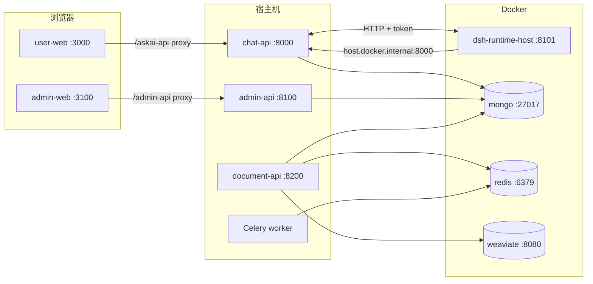

# MOVO 混合开发指南

混合开发指：**基础设施与 DSH Runtime 跑在 Docker**，**Python 后端（chat-api / admin-api / document-parser）在宿主机源码运行**，前端通常用 Vite 本地 dev server。便于断点调试后端，同时与生产拓扑（Mongo / Redis / Weaviate / DSH）保持一致。

---

## 1. 架构概览




要点：

- 浏览器**不**直连 DSH；对话经 **chat-api ↔ DSH Runtime Host（8101）**。
- DSH 在容器内执行 Agent，**模型与工具**通过 HTTP 回调宿主机 chat-api 的 `/internal/dsh/model/`*、`/internal/dsh/tools/`*。
- 容器内 `127.0.0.1` 指向容器自身，**不能**当作宿主机 chat-api；混合模式下应使用 `host.docker.internal:8000`（Windows Docker Desktop 默认；见下文配置）。

---


## 2. 改动点说明

以下为混合开发相关的主要仓库变更（与全 Docker 栈、`dev.sh` 并存）。


| 路径                                                 | 作用                                                                                                                    |
| -------------------------------------------------- | --------------------------------------------------------------------------------------------------------------------- |
| `docker-compose.host-deps.yml`                     | Compose **overlay**：向宿主机发布 mongo/redis/weaviate/DSH 等端口；为 `dsh-runtime-host` 配置 `host.docker.internal` 与模型/工具网关 URL。  |
| `services/run_backends.py`                         | 统一启动 chat-api、admin-api、document-parser API、Celery worker；注入 Mongo/Redis/DSH 等环境变量；可从 Docker volume 同步 `runtime.env`。 |
| `services/__main__.py`                             | 支持在仓库根目录执行 `python -m services`。                                                                                      |
| `services/requirements.txt`                        | **混合开发唯一依赖入口**（`-r chat-api/requirements.txt` + Celery）；勿与 `document-parser/requirements.txt` 混装同一 venv。              |
| `scripts/dev/internal_service_auth.py`             | 与 `internal_service_auth.sh` 对齐：生成本地服务间 Token（无 Docker 时）。                                                            |
| `scripts/dev/sync_runtime_secrets.ps1` / `.sh`     | 从 Docker `deployment-secrets` volume 拷贝 `runtime.env` 到 `.movo-dev/runtime.env`。                                      |
| `scripts/dev/verify_dsh_auth.ps1`                  | 校验宿主机能否用 Token 访问 `http://127.0.0.1:8101/health`。                                                                     |
| `services/chat-api/app/core/config.py`             | 加载 `.movo-dev/runtime.env`；Windows 混合模式下将 DSH 网关 URL 重写为 `host.docker.internal:{BACKEND_PORT}`。                       |
| `services/chat-api/app/dsh_runtime/application.py` | DSH 健康检查失败时输出明确日志（Token / sync 脚本提示）。                                                                                 |
| `services/chat-api/app/dsh_runtime/transport.py`   | 每次请求解析 Bearer Token，便于更新 `runtime.env` 后无需改代码。                                                                        |
| `services/chat-api/.../script_engine/executor.py`  | Windows 无 `resource` 模块时的兼容处理。                                                                                        |


未提交、仅本地使用（**不要进 Git**）：

- `.movo-dev/runtime.env`、`.movo-dev/admin_jwt_secret`
- `services/chat-api/.env`（含模型 Key 等）
- 根目录 `.env`（`MOVO_VOLUME_PREFIX` 等）

---


## 3. 端口速查


| 服务                | 默认端口  | 混合模式下常见位置                 |
| ----------------- | ----- | ------------------------- |
| gateway（全 Docker） | 3000  | 可选；混合常用 Vite 代替           |
| user-web（Vite）    | 3000  | 宿主机                       |
| admin-web（Vite）   | 3100  | 宿主机                       |
| chat-api          | 8000  | 宿主机（`python -m services`） |
| admin-api         | 8100  | 宿主机                       |
| dsh-runtime-host  | 8101  | Docker                    |
| document-api      | 8200  | 宿主机                       |
| mongo             | 27017 | Docker（host-deps 发布）      |
| redis             | 6379  | Docker（host-deps 发布）      |
| weaviate          | 8080  | Docker（host-deps 发布）      |


环境变量覆盖端口：`BACKEND_PORT`、`ADMIN_API_PORT`、`DOC_PROCESSING_PORT`、`MOVO_HOST_BACKEND_PORT`（须与 chat-api 实际监听端口一致，供 DSH 容器回调）。

---


## 4. Docker 启动


### 4.1 前置

- 已安装 Docker Desktop（Windows/macOS）或 Docker Engine（Linux）。
- 仓库根目录存在 `.env`（至少 `MOVO_VOLUME_PREFIX=movo`，与首次 `bootstrap` 一致）。
- 首次需拉取/构建镜像时，可配合 `docker-compose.build.yml`（`MOVO_VERSION=local` 等，见根目录 `.env`）。


### 4.2 推荐：仅基础设施 + DSH（混合后端在宿主机）

在仓库根目录：

```bash
docker compose -f docker-compose.yml -f docker-compose.host-deps.yml up -d bootstrap mongo redis weaviate dsh-runtime-host
```

说明：

- `bootstrap` 生成密钥并写入 volume `{MOVO_VOLUME_PREFIX}_deployment-secrets`。
- **不要**同时启动 Docker 里的 `chat-api` / `admin-api`，否则会与宿主机 8000/8100 冲突，且 DSH 可能仍解析已退出的 `chat-api` 容器主机名。

若曾用旧 compose 起过 DSH，修改 `host-deps` 后建议重建：

```bash
docker compose -f docker-compose.yml -f docker-compose.host-deps.yml up -d --force-recreate dsh-runtime-host
```


### 4.3 全栈 Docker + 宿主机端口（调试容器版 API）

```bash
docker compose -f docker-compose.yml -f docker-compose.build.yml -f docker-compose.host-deps.yml up -d
```

此时 chat-api 在容器内，网关 URL 为 `http://chat-api:8000/...`，**不再**是混合模式；前端仍可在宿主机用 Vite，代理到 `127.0.0.1:8000/8100`。

### 4.4 同步密钥到宿主机

bootstrap 完成后执行一次（改 volume 或重装 bootstrap 后需重做）：

**PowerShell：**

```powershell
.\scripts\dev\sync_runtime_secrets.ps1
```

**Git Bash / Linux / macOS：**

```bash
./scripts/dev/sync_runtime_secrets.sh
```

生成 `.movo-dev/runtime.env`（含 `DSH_RUNTIME_HOST_TOKEN`、`DSH_MODEL_GATEWAY_SIGNING_SECRET` 等）。  
`run_backends.py` 启动时会读取；若缺少 Token，也会尝试从 Docker volume 自动拉取。

校验 DSH：

```powershell
.\scripts\dev\verify_dsh_auth.ps1
```

期望 `HTTP_CODE:200`。

### 4.5 查看状态

```bash
docker compose -f docker-compose.yml -f docker-compose.host-deps.yml ps
```

混合开发时通常应看到 **mongo / redis / weaviate / dsh-runtime-host** 为 `Up`；应用容器可不启动。

---


## 5. 本地（宿主机）启动


### 5.1 Python 环境

在仓库根目录：  

# Windows

pip install -r services\requirements.txt  

`services/document-parser/requirements.txt` 仅用于 **document-parser 镜像** 与 `dev.sh` **独立** `.venv`，pin 与 chat-api 不一致；混合模式请只装上一行的 `services/requirements.txt`。

可选：安装 Docling（与 document-parser 镜像能力对齐，体积较大）：

```bash
pip install -r services/document-parser/requirements-docling.txt
```

未安装 Docling 时，`http://127.0.0.1:8200/api/ready` 可能为 **503**（`docling: false`），知识库解析受限；**生成 Excel 等 chat 工具**主要依赖 chat-api + DSH，不强制要求 Docling。

### 5.2 配置 chat-api

复制并编辑 `services/chat-api/.env`（参考 `.env.example`）：

- `MONGODB_URI=mongodb://127.0.0.1:27017`
- `STORAGE_BACKEND=local`（本地产物走磁盘 + `/askai-api/api/files`）
- 配置可用的 `OPENAI_*` 或企业模型（否则对话无法调模型）

`END_USER_AUTH_SECRET` 等可为空：有 `.movo-dev/runtime.env` 时由 `config.py` 合并。

### 5.3 启动后端

在仓库根目录：

```bash
# 使用统一 venv 的 Python
services\.venv\Scripts\python -m services
```

**PyCharm（推荐分服务跑，控制台可见完整日志）**

每个服务有独立入口，在当前进程内跑 uvicorn/Celery（不是 `run_backends` 的子进程）：


| Run Configuration（Script path）               | Working directory          | 说明                 |
| -------------------------------------------- | -------------------------- | ------------------ |
| `services/chat-api/run_dev.py`               | `services/chat-api`        | chat-api :8000     |
| `services/admin-api/run_dev.py`              | `services/admin-api`       | admin-api :8100    |
| `services/document-parser/run_dev.py`        | `services/document-parser` | document API :8200 |
| `services/document-parser/run_worker_dev.py` | `services/document-parser` | Celery worker      |


Interpreter 选 `services/.venv`。可用 **Compound** 一次启动多个 Run Configuration。CLI 参数与 `python -m services` 类似（如 `--reload`、`--chat-port`）。

常用参数：


| 参数                                | 说明                              |
| --------------------------------- | ------------------------------- |
| `--only chat-api`                 | 仅 chat-api                      |
| `--only admin-api`                | 仅 admin-api                     |
| `--skip-redis-check`              | 不检查 Redis（不启 document worker 时） |
| `--no-reload`                     | 关闭 uvicorn 热重载（Windows 默认关闭）    |
| `--reload`                        | 开启热重载（Linux/macOS 默认开启）         |
| `--chat-port` / `BACKEND_PORT`    | chat-api 端口，默认 8000             |
| `--admin-port` / `ADMIN_API_PORT` | admin-api 端口，默认 8100            |


Windows 若 8000 被占用，launcher 可能自动选用 8001 等；此时需同步：

- 环境变量 `BACKEND_PORT`
- `MOVO_HOST_BACKEND_PORT`（Docker DSH 回调）
- 前端 `VITE_AIGC_API_TARGET` / `VITE_LEGACY_API_TARGET`

启动成功日志应包含：

- `http://127.0.0.1:8000/docs`（chat-api）
- `http://127.0.0.1:8100/docs`（admin-api）
- Windows：`DSH gateway URLs use host.docker.internal:8000 ...`

健康检查：

```bash
curl http://127.0.0.1:8000/ready
curl http://127.0.0.1:8100/api/setup/status
curl http://127.0.0.1:8200/api/ready
```


### 5.4 启动前端

**员工端（user-web）：**

```bash
cd apps/user-web
npm install
npm run dev
```

默认 `http://localhost:3000`，Vite 将 `/askai-api` 代理到 `http://127.0.0.1:8000`（可用 `VITE_AIGC_API_TARGET` 覆盖）。

**管理端（admin-web）：**

```bash
cd apps/admin-web
npm install
npm run dev
```

默认 `http://localhost:3100`，`/admin-api` 代理到 `http://127.0.0.1:8100`（见 `apps/admin-web/.env.example` 中 `VITE_ADMIN_API_TARGET`）。

若 admin-api 不在 8100，**必须**设置 `VITE_ADMIN_API_TARGET`，否则 Vite 代理连不上会出现 **500**。

### 5.5 macOS / Linux 替代：`dev.sh`

未使用 Docker 跑 DSH 时，可用 `dev.sh` 在单机起全部进程（含 Redis 本机检查）。  
**与 Docker DSH 混合时**，仍建议：`host-deps` 起 infra + DSH，后端用 `python -m services`，避免重复启动 chat-api 与错误网关 URL。

---


## 6. 关键环境变量


| 变量                                                        | 含义                                                                          |
| --------------------------------------------------------- | --------------------------------------------------------------------------- |
| `MOVO_VOLUME_PREFIX`                                      | Docker volume 前缀，默认 `movo`，与 `.env` 一致                                      |
| `MOVO_HOST_BACKEND_PORT`                                  | DSH 容器回调宿主机 chat-api 的端口，默认 `8000`                                          |
| `MOVO_DSH_CALLBACK_HOST`                                  | 写入 Profile 的网关主机；Windows 默认 `host.docker.internal`；DSH 也在宿主机时设为 `127.0.0.1` |
| `BACKEND_PORT` / `ADMIN_API_PORT` / `DOC_PROCESSING_PORT` | 宿主机后端端口                                                                     |
| `ASKAI_REDIS_URL`                                         | 默认 `redis://127.0.0.1:6379/0`                                               |
| `MONGODB_URI` / `MONGODB_DB`                              | 默认 `mongodb://127.0.0.1:27017`、`gragentic`                                  |


---


## 7. 常见问题


### 7.1 admin-web 请求 `/admin-api/...` 返回 500

Vite 默认代理到 `http://127.0.0.1:8100`，但 admin-api 若跑在其他端口（例如旧默认 8801），会连接失败。  
**处理：** 保证 admin-api 监听 8100，或设置 `VITE_ADMIN_API_TARGET`。

### 7.2 对话里工具失败（网络解析 / 后端不可达）

- Docker 里 **chat-api 容器已停**，但 DSH 仍访问 `http://chat-api:8000` → 容器内 DNS **ENOTFOUND**。
- Profile 里网关为 `http://127.0.0.1:8000`，DSH 在容器内访问 → **ECONNREFUSED**。

**处理：**

1. 混合模式只起 infra + DSH，chat-api 用 `python -m services`（8000）。
2. `sync_runtime_secrets` 后**重启** chat-api。
3. **新开对话**（旧 Session 可能缓存错误网关）。
4. `--force-recreate dsh-runtime-host` 确保 `host-deps` 环境生效。


### 7.3 `DSH_RUNTIME_HOST_TOKEN is missing`

先 `docker compose ... up -d bootstrap`，再 `sync_runtime_secrets`，然后重启 `python -m services`。

### 7.4 `/ready` 中 `dsh_host` 不健康

检查 8101、Token 与 `verify_dsh_auth.ps1`；确认 chat-api 的 `DSH_RUNTIME_HOST_URL=http://127.0.0.1:8101`。

### 7.5 document-parser 503

多为未装 Docling 或未起 Celery worker。需要完整文档流水线时：  
`python -m services`（默认起 worker），并按需安装 `requirements-docling.txt`。

---


## 8. 推荐日常流程（Windows 混合）

1. `docker compose -f docker-compose.yml -f docker-compose.host-deps.yml up -d bootstrap mongo redis weaviate dsh-runtime-host` jira-mcp-gateway
2. `.\scripts\dev\sync_runtime_secrets.ps1`
3. 仓库根目录：`services\.venv\Scripts\python -m services`
4. 终端分别：`apps/user-web`、`apps/admin-web` 的 `npm run dev`
5. 浏览器：`http://localhost:3000`（员工端）、`http://localhost:3100`（管理端）

---


## 9. Fork 分支（main / custom）

本仓库为 [himovo/movo](https://github.com/himovo/movo) 的 fork，采用双分支降低与上游同步时的冲突成本：


| 分支         | 用途             | 跟踪              |
| ---------- | -------------- | --------------- |
| **main**   | 与上游一致，仅用于同步    | `upstream/main` |
| **custom** | 全部定制开发（默认在此工作） | `origin/custom` |


**日常开发**：`git checkout custom`

**同步上游**（在干净工作区执行）：

```powershell
git fetch upstream
git checkout main
git merge upstream/main
git push origin main

git checkout custom
git merge main
# 若有冲突在此解决，然后：git push origin custom
```

`origin/main` 已与上游对齐；历史定制提交均在 **custom** 上。

---


## 10. Jira MCP 网关（可选 profile）

Jira 集成使用独立容器 `jira-mcp-gateway`（supergateway + parassolanki），MOVO 通过 Streamable HTTP 调用。

1. 启动网关（混合开发需带 `host-deps`，且 **不要** 连带启动容器版 `admin-api`/`document-api`，避免占用宿主机 8200）：

```powershell
docker compose -f docker-compose.yml -f docker-compose.host-deps.yml --profile jira-mcp up -d --build jira-mcp-gateway
```

宿主机需已运行 `admin-api`（`run_backends`），网关通过 `host.docker.internal:8100` 拉配置。

1. 管理后台 **工具与 MCP → Jira MCP 网关** 填写：
  - Jira 站点 URL
  - `邮箱:API Token`
  - 网关 Bearer 密钥（可自动生成）
2. **MOVO 访问方式**（与 chat-api 部署一致）：
  - chat-api 在 Compose 内：外部 MCP 工具地址 `http://jira-mcp-gateway:8766/mcp`
  - chat-api 在宿主机：选「本机回环」→ `http://127.0.0.1:8766/mcp`

保存后网关约 15s 内热重载该租户子进程；再到关联 MCP 工具页 **发现工具**、启用并配置 Skill。

详见 `[services/jira-mcp-gateway/README.md](services/jira-mcp-gateway/README.md)`。

---


## 11. 相关文件索引


| 主题          | 路径                                             |
| ----------- | ---------------------------------------------- |
| Compose 主文件 | `docker-compose.yml`                           |
| 混合 overlay  | `docker-compose.host-deps.yml`                 |
| Jira MCP 网关 | `services/jira-mcp-gateway/`                   |
| 后端启动器       | `services/run_backends.py`                     |
| Bash 全本地启动  | `dev.sh`                                       |
| 内部服务鉴权      | `scripts/dev/internal_service_auth.sh` / `.py` |
| Nginx 全栈路由  | `deploy/docker/nginx.conf`                     |


